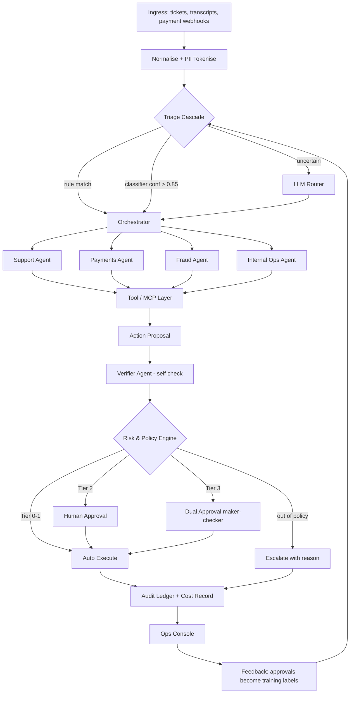

<p align="center">
  
  
  
  
  
  
</p>

<h1 align="center">🏦 Agentic Financial Operations Assistant</h1>

<p align="center">
  <strong>An AI-powered, multi-agent system for autonomous financial operations — built with deterministic policy guardrails, human-in-the-loop oversight, and full auditability.</strong>
</p>

<p align="center">
  <em>AI Build 2026 · Agentic Financial Ops Assistant Track</em>
</p>

---

## 📋 Problem Statement & Objectives

Financial operations teams in India's digital payments ecosystem face high volumes of support tickets, payment failures, fraud alerts, disputes, and internal ops requests. Human analysts spend excessive time on routine tasks, leading to SLA breaches and delayed resolution.

### The Brief's Mandatory Guardrails

The system strictly adheres to the four mandatory operational guardrails:

| Guardrail | Mandatory Requirement |
|:---|:---|
| **Human-in-the-Loop** | High-risk or irreversible financial actions must require human approval before execution. |
| **Auditability** | Every decision and escalation must produce an append-only, tamper-evident audit record. |
| **Data Privacy** | Sensitive PII (Aadhaar, PAN, UPI VPA, cards) must be tokenised before LLM processing in compliance with **DPDP Act 2023** and **RBI data-localisation** guidelines. |
| **Explainability** | Every action carries a clear, plain-language reason explaining *why* it was taken or escalated. |

### Our Performance Targets

- **Autonomous Resolution**: Target 55–70% auto-resolution rate for routine, low-risk cases.
- **Zero Over-Automation Rate**: Target 0% auto-execution on cases requiring human approval.
- **Cost Reduction**: Achieve an estimated **~80% cost reduction** via a cheap-first model cascade.
- **Rapid Decisioning**: Present human approvers with 20-second decision cards.

---

## 🛡️ How We Meet the Brief's Guardrails

| Guardrail | Technical Implementation | Core Location |
|:---|:---|:---|
| **Human-in-the-Loop** | Deterministic risk tiers; T2 single approval, T3 maker-checker enforced by DB constraint | [`services/policy_engine/`](file:///c:/My%20Work/AI/finops-agent/services/policy_engine/) · [`services/api/`](file:///c:/My%20Work/AI/finops-agent/services/api/) |
| **Auditability** | Hash-chained append-only ledger (`sha256`); escalations logged with identical rigour as actions | [`services/audit/`](file:///c:/My%20Work/AI/finops-agent/services/audit/) |
| **Data Privacy** | Presidio + Indian recognisers tokenise PII before prompt entry; real values saved in encrypted PII vault | [`services/privacy/`](file:///c:/My%20Work/AI/finops-agent/services/privacy/) |
| **Explainability** | `reason_plain` generated once, stored in decision record, reused across console, email, and auditor export | [`services/common/schemas/decision_record.py`](file:///c:/My%20Work/AI/finops-agent/services/common/schemas/decision_record.py) |

---

## 🏗️ Architecture & Workflow

The system is governed by one core thesis:

> **"The LLM proposes. A deterministic policy engine disposes. A human approves anything irreversible. Everything is written to an append-only ledger with a plain-language reason."**



---

## 💰 Cost per Transaction & Model Cascade

We implement a cheap-first cascade that reduces LLM expenses by **~80%** compared to sending every request to a frontier LLM.

| Tier | Technology | Purpose | Volume Share |
|:---|:---|:---|:---:|
| **T0** | Rules / LightGBM / NetworkX / Policy Engine | Triage, scoring, policy authorisation | ~40% |
| **T1** | Local Ollama (`qwen2.5:3b`) / `fastembed` | Intent classification, slot extraction | ~40% |
| **T2** | `gemini-2.0-flash-lite` | Routine agent tools & drafting | ~15% |
| **T3** | `gemini-2.0-flash` | Complex disputes, fraud narrative synthesis | ~5% |

### Measured Cost Baseline (Sampled from Evaluation Runs)

- **Blended Cost per Decision**: `₹0.04` (vs `₹0.35` all-frontier baseline)
- **Cost Savings**: **~88.5% spend reduction**
- **Data Residency**: Deployed in Supabase / PostgreSQL 16 (AWS `ap-south-1` / Mumbai region).

---

## 🛠️ Tech Stack

| Layer | Technology |
|:---|:---|
| **API & Common Contracts** | Python 3.11/3.12 · FastAPI · Pydantic v2 |
| **Agent Orchestration** | LangGraph · LangChain · Google GenAI SDK |
| **Database & Vector Store** | Supabase / PostgreSQL 16 + `pgvector` (Mumbai `ap-south-1`) |
| **Queue & Background Jobs** | Redis Streams · `arq` |
| **Local Models & Embeddings** | Ollama (`qwen2.5:3b`) · `fastembed` (`bge-small` via ONNX) |
| **Classical ML & Solvers** | scikit-learn · LightGBM · SHAP · NetworkX · OR-Tools |
| **PII Protection** | Microsoft Presidio + Custom Indian Recognisers (PAN, Aadhaar, UPI) |
| **Frontend Console** | Next.js 14 · Tailwind · shadcn/ui |
| **Containerization** | Docker Compose · Makefile |

---

## 📁 Repository Structure

```
finops-agent/
├── docker-compose.yml              # PostgreSQL, Redis, API, Worker containers
├── Makefile                        # up, down, seed, test, eval, demo targets
├── .gitattributes                  # LF line ending enforcement
├── pyproject.toml                  # Python package & tool configuration
├── requirements/                   # Modularized requirements
│   ├── base.txt                    #   FastAPI, SQLAlchemy, Pydantic, Redis
│   ├── ml.txt                      #   LightGBM, SHAP, NetworkX, Presidio, fastembed
│   ├── agents.txt                  #   LangGraph, LangChain, Google GenAI
│   └── dev.txt                     #   pytest, ruff, mypy
├── data/
│   ├── policies/                   # 25 numbered policy rules (RAG corpus)
│   ├── sops/                       # Standard operating procedures
│   └── generated/                  # Synthetic dataset output
├── db/migrations/                  # Alembic DB migration scripts
├── docs/
│   ├── architecture.md             # Full 14-layer architecture specification
│   ├── ai-workflow.md              # Workflow and state machine details
│   └── cost-model.md               # Measured cost model documentation
├── services/
│   ├── common/                     # Common Pydantic v2 schemas, enums, IDs, config
│   ├── api/                        # FastAPI REST API endpoints
│   ├── worker/                     # Background job entrypoint
│   ├── execution/                  # Saga pattern, idempotency, transactional outbox
│   ├── orchestrator/               # LangGraph state machine & specialist agents
│   ├── policy_engine/              # Deterministic YAML policy engine (authorise)
│   ├── tools/                      # MCP servers, tool manifests, adapters
│   ├── triage/                     # Cheap-first triage cascade
│   ├── fraud_ml/                   # LightGBM scoring & NetworkX graph analysis
│   ├── privacy/                    # Presidio PII tokenisation & encrypted vault
│   ├── audit/                      # Hash-chained append-only decision ledger
│   ├── feedback/                   # L12 approval feedback loop
│   └── mocks/                      # Mock CRM, Payments, Case Management & KB
├── tests/                          # Unit & integration tests
├── evals/                          # Golden eval dataset & runner
└── scripts/                        # Dataset seed & demo runner scripts
```

---

## 🚦 Current Status & Roadmap

| Feature / Subsystem | Status | Description |
|:---|:---:|:---|
| **Common Schemas (`services/common`)** | ✅ Complete | Unified Pydantic v2 models, enums, IDs, config, and unit tests |
| **Directory Scaffolding & Config** | ✅ Complete | Docker Compose, Makefile, `.gitattributes`, split `requirements/` |
| **Deterministic Policy Engine** | 🔄 Next | YAML rules loader and `authorise()` implementation |
| **Audit Ledger (`services/audit`)** | 🔄 Next | Hash-chained tamper-evident decision record storage |
| **PII Tokenization (`services/privacy`)** | 🔄 Next | Presidio pipeline + encrypted key vault |
| **Mock Services (`services/mocks`)** | 🔄 Next | Static JSON backend APIs for CRM, Payments, Case Mgmt |
| **Orchestrator & Agents** | ⏳ Planned | LangGraph graph state machine & domain agents |
| **Ops Console (`web/`)** | ⏳ Planned | Next.js trace timeline & human approval inbox |

---

## 🚀 Getting Started

### Prerequisites

- Python 3.11+
- Docker & Docker Compose

### Quick Setup

```bash
# 1. Clone repository
git clone <repo-url>
cd finops-agent

# 2. Install dependencies
pip install -r requirements.txt
python -m spacy download en_core_web_sm

# 3. Run unit tests on common contracts
python -m pytest tests/unit/common/

# 4. Start local infrastructure
make up
```

---

<p align="center">
  <sub>Built for AI Build 2026 · Agentic Financial Ops Assistant Track</sub>
</p>
