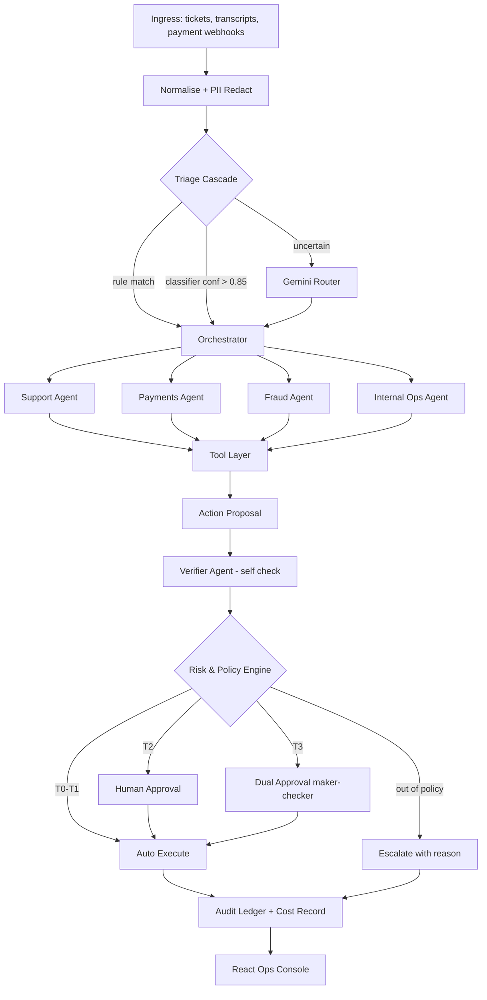

<p align="center">
  
  
  
  
  
</p>

<h1 align="center">🏦 Agentic Financial Operations Assistant</h1>

<p align="center">
  <strong>An AI-powered, multi-agent system for autonomous financial operations — built with deterministic policy guardrails, human-in-the-loop oversight, and full auditability.</strong>
</p>

<p align="center">
  <em>AI Build 2026 · Agentic Financial Ops Assistant Track</em>
</p>

---

## 📋 Problem Statement & Objectives

Financial operations teams in India's digital payments ecosystem face high volumes of support tickets, payment failures, fraud alerts, disputes, and internal ops requests. Human analysts spend excessive time on routine tasks, leading to SLA breaches and delayed resolution.

### The Brief's Mandatory Guardrails

| Guardrail | Mandatory Requirement |
|:---|:---|
| **Human-in-the-Loop** | High-risk or irreversible financial actions must require human approval before execution. |
| **Auditability** | Every decision and escalation must produce an append-only, tamper-evident audit record. |
| **Data Privacy** | Sensitive PII (Aadhaar, PAN, UPI VPA, cards) must be tokenised before LLM processing in compliance with **DPDP Act 2023** and **RBI data-localisation** guidance. |
| **Explainability** | Every action carries a clear, plain-language reason explaining *why* it was taken or escalated. |

### Measured Results (not projections — see `docs/cost-model.md`)

- **75.0% auto-resolution rate**, measured from a real demo run.
- **0% over-automation rate** in the golden evaluation set (`evals/runner.py`) — the safety metric that matters most.
- **98.6% cost reduction** vs. an all-frontier-LLM baseline, from the cheap-first cascade.
- **4/4 prompt-injection scenarios defended** — verified directly, not asserted.

---

## 🛡️ How We Meet the Brief's Guardrails

| Guardrail | Technical Implementation | Core Location |
|:---|:---|:---|
| **Human-in-the-Loop** | Deterministic risk tiers; T2 single approval, T3 maker≠checker enforced by a DB `UNIQUE` constraint | [`services/policy_engine/`](services/policy_engine/) · [`services/orchestrator/approvals.py`](services/orchestrator/approvals.py) |
| **Auditability** | Hash-chained append-only ledger (`sha256`); escalations logged with identical rigour to executed actions | [`services/audit/`](services/audit/) |
| **Data Privacy** | Regex + checksum Indian PII recognisers tokenise PII before it reaches a prompt; real values held in an AES-GCM vault | [`services/privacy/`](services/privacy/) |
| **Explainability** | `reason_plain` generated once by the policy engine, stored on the decision record, reused everywhere it's shown | [`services/common/schemas/decision_record.py`](services/common/schemas/decision_record.py) |

---

## 🏗️ Architecture & Workflow

> **"The LLM proposes. A deterministic policy engine disposes. A human approves anything irreversible. Everything is written to an append-only ledger with a plain-language reason."**



This project started from a 14-layer reference architecture (`docs/architecture.md`) and was deliberately scoped down for a hackathon build — MySQL instead of Supabase/Postgres, a hand-rolled orchestrator instead of LangGraph, no Redis/Celery, regex PII recognisers instead of Presidio. **`docs/LEARN.md` explains every one of these choices in detail** — what was cut, why, and what real bugs were found and fixed along the way. Read it if you want to actually learn from this codebase, not just run it.

---

## 💰 Cost per Transaction & Model Cascade

| Tier | Technology | Purpose |
|:---|:---|:---|
| **T0** | Regex rules, deterministic policy engine | Triage for known patterns, all authorisation |
| **T1** | `fastembed` + logistic regression, LightGBM + SHAP + networkx | Intent classification, fraud scoring — no LLM |
| **T2** | `gemini-flash-lite-latest` | Routine agent tool-calling, triage fallback |
| **T3** | `gemini-flash-latest` | Ambiguous triage, fraud narrative synthesis |

**Blended cost per decision: ₹0.0027** (98.6% below the all-frontier baseline), measured by running `scripts/demo_driver.py` + `evals/runner.py` against a freshly seeded database and reading `GET /dashboard/summary` — see `docs/cost-model.md` for the full breakdown and how to reproduce it yourself.

---

## 🛠️ Tech Stack

| Layer | Technology |
|:---|:---|
| **API & Common Contracts** | Python 3.11/3.12 · FastAPI · Pydantic v2 |
| **Agent Orchestration** | Hand-rolled state machine (`services/orchestrator/graph.py`) · `google-genai` |
| **Database** | MySQL 8 · SQLAlchemy (sync) + PyMySQL |
| **Local Models & Embeddings** | `fastembed` (`bge-small-en-v1.5` via ONNX) |
| **Classical ML & Solvers** | scikit-learn · LightGBM · SHAP · NetworkX |
| **PII Protection** | Regex + checksum Indian recognisers (PAN, Aadhaar, card, UPI, IFSC) + AES-GCM vault |
| **Auth** | Hand-rolled JWT (PyJWT) + bcrypt, RBAC roles |
| **Frontend Console** | React 18 · Vite · TypeScript · Tailwind CSS |
| **Containerisation (optional, local dev only)** | Docker Compose · Makefile — not used for deployment/CI |

See `docs/LEARN.md` §1 for why each of these was chosen over the original spec's Postgres/LangGraph/Presidio/Redis/Next.js stack.

---

## 📁 Repository Structure

```
finops-agent/
├── docker-compose.yml          # optional local convenience (MySQL + API + web) — not the deployment path
├── Makefile                    # up, migrate, seed, load-seed, index-policies, test, eval, demo
├── db/schema.sql               # MySQL DDL, applied by scripts/migrate.py
├── data/
│   ├── policies/ sops/         # placeholders — real corpus is generated (see below)
│   └── generated/              # synthetic dataset output (regenerate with `make seed`)
├── docs/
│   ├── architecture.md         # original 14-layer reference spec
│   ├── LEARN.md                # what's actually built, why, and every real bug found along the way
│   ├── ai-workflow.md          # state machine / agent workflow
│   ├── cost-model.md           # measured cost model, with real numbers
│   └── pitch.md                # business pitch
├── services/
│   ├── common/                 # Pydantic v2 schemas, enums, IDs, config, DB engine, LLM client, cost estimator
│   ├── api/                    # FastAPI routers: ingress, cases, approvals, audit, auth, compliance, dashboard
│   ├── auth/                   # JWT + bcrypt
│   ├── orchestrator/            # state machine, case store, approvals, resume, agents/
│   │   └── agents/             # support.py payments.py fraud.py internal_ops.py compliance.py verify.py
│   ├── policy_engine/          # deterministic YAML rules + authorise() — zero LLM calls
│   ├── tools/                  # manifest registry + executor (idempotency, dry-run)
│   ├── triage/                 # rules -> classifier -> LLM cascade
│   ├── fraud_ml/               # feature engineering, LightGBM training, SHAP scoring, networkx linkage
│   ├── privacy/                # PII recognisers, redactor, AES-GCM vault
│   ├── audit/                  # hash-chained ledger + signed export
│   └── mocks/                  # CRM, Payments, CaseMgmt, KB adapters over the seeded MySQL tables
├── web/                        # React console (Vite + TS + Tailwind)
├── evals/                      # golden set generator + runner
├── scripts/                    # seed.py, load_seed.py, migrate.py, train scripts, demo_driver.py
└── tests/                      # unit + integration tests (141 passing)
```

---

## 🚦 Status

All 14 build steps are complete: ingress/privacy, policy engine, audit ledger, tool layer, triage cascade, all four domain agents + Verifier + Compliance, human-in-the-loop approvals, the React console, and the golden evaluation set. 141 backend tests passing; all 5 golden-path demo scenarios (`docs/architecture.md` §6) verified end to end, including through the actual browser UI.

---

## 🚀 Getting Started

### Prerequisites

- Python 3.11+
- MySQL 8 (a local server, or `docker compose up mysql` for a disposable one)
- Node.js 18+ (for the React console)
- A Gemini API key (free tier works — [ai.google.dev](https://ai.google.dev))

### Setup

```bash
# 1. Clone and install Python dependencies
git clone <repo-url>
cd finops-agent
pip install -r requirements.txt

# 2. Configure environment
cp .env.example .env
# edit .env: set GEMINI_API_KEY and a MySQL DATABASE_URL for a database/user you have access to

# 3. Create the schema, generate + load synthetic data, index policies for search
python scripts/migrate.py
python scripts/seed.py
python scripts/load_seed.py
python scripts/index_policies.py
python services/triage/train.py
python -m services.fraud_ml.train
python scripts/seed_users.py

# 4. Run the backend
uvicorn services.api.main:app --reload

# 5. Run the frontend (separate terminal)
cd web
npm install
npm run dev
# open http://localhost:5173 — log in as approver_alice / demo1234 (see scripts/seed_users.py for all demo accounts)
```

### Verify it all works

```bash
pytest tests/                    # 141 tests
python evals/runner.py           # golden set: triage accuracy, injection defense, over-automation rate
python scripts/demo_driver.py    # the 5 golden-path scenarios from docs/architecture.md §6, end to end
```

`make up` will bring up a local MySQL container plus the API and web containers via Docker Compose, if you'd rather not install MySQL/Node directly — this is offered purely as a local convenience, not as the deployment or CI/CD path.

---

<p align="center">
  <sub>Built for AI Build 2026 · Agentic Financial Ops Assistant Track</sub>
</p>
