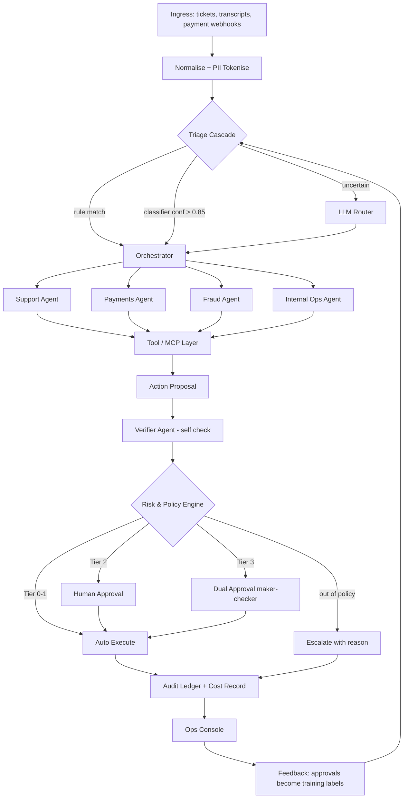

# Agentic FinOps Assistant — AI Workflow Specification

## Overview

The AI Workflow implements a **Plan → Act → Observe → Verify** execution loop using LangGraph, governed by deterministic policy guardrails.

## Agent Roles & Tiers

1. **Support Agent (T1/T2)**: Handles customer queries, context retrieval, drafting replies.
2. **Payments Agent (T2)**: Reconciles failed transactions, proposes retries or refunds.
3. **Fraud Agent (Classical ML + LLM Narrative)**: LightGBM scores risk features (amount z-score, velocity, geo-ip), NetworkX computes linked graph entities, LLM writes plain-language SHAP memo.
4. **Compliance Advisor Agent (T2)**: RAG search over policy docs (25 clauses) to provide compliance citations.
5. **Verifier Agent (T2/T3)**: Automated self-check evaluating business goals and policy conformance before policy engine gate.

## Execution Bounds & Safety Rules

- **Max tool calls**: 6 per case.
- **Max reasoning revisions**: 3 per case.
- **Budget cap**: max ₹5.00 LLM cost per case.
- **Abstention threshold**: Escalation to human analyst when confidence < 0.85.
