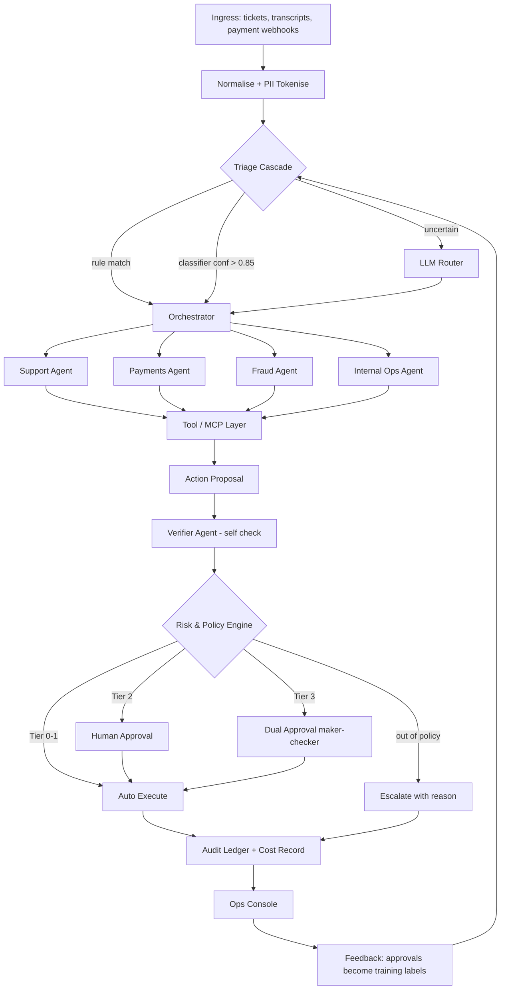

# Agentic FinOps Assistant — AI Workflow Specification

> **As-built note:** the state machine described here is implemented as a
> hand-rolled orchestrator (`services/orchestrator/graph.py`), not
> LangGraph — see `docs/LEARN.md` §4 for why. The states, transitions, and
> agent roles below are otherwise exactly what's running.

## Overview

The AI Workflow implements a **Plan → Act → Observe → Verify** execution loop, governed by deterministic policy guardrails.

## Agent Roles & Tiers

1. **Support Agent (no LLM)**: Handles status/KYC queries and templated replies straight from CRM/payments lookups — template-driven, not LLM-drafted, so the decision path is genuinely ₹0.
2. **Payments Agent (no LLM)**: Reconciles failed transactions, proposes refunds/fee waivers/card unblocks from the system of record; routes disputes it can't safely resolve to a human.
3. **Fraud Agent (Classical ML decides, LLM narrates)**: LightGBM scores risk features (amount z-score, 24h velocity, device-sharing), NetworkX finds linked accounts via connected components, `gemini-flash-lite-latest` writes the plain-language memo from the SHAP attributions and linkage result — it does not decide anything.
4. **Internal Ops Agent (no LLM)**: Routes internal requests to the workflow catalogue and always creates a tracked human task — deliberately does not decide anything itself.
5. **Compliance Agent (RAG, read-only, no LLM)**: Cosine-similarity search over 25 embedded policy clauses (`fastembed`, NumPy) for citations — a citation service other agents/the console call directly, not a case-owning domain agent.
6. **Verifier Agent (deterministic, no LLM)**: Self-check against a Business Goals checklist before the risk gate — checks the proposed amount against what the customer's own message named, among other things. Deterministic, not LLM-driven, for the same reason the policy engine is: a safety check shouldn't depend on an LLM's mood.

## Execution Bounds & Safety Rules

- **Max tool calls**: 6 per case.
- **Max reasoning revisions**: 3 per case.
- **Budget cap**: max ₹5.00 LLM cost per case.
- **Abstention threshold**: Escalation to human analyst when confidence < 0.85.
